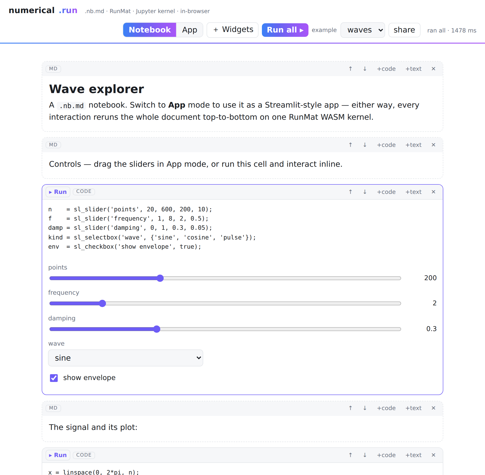
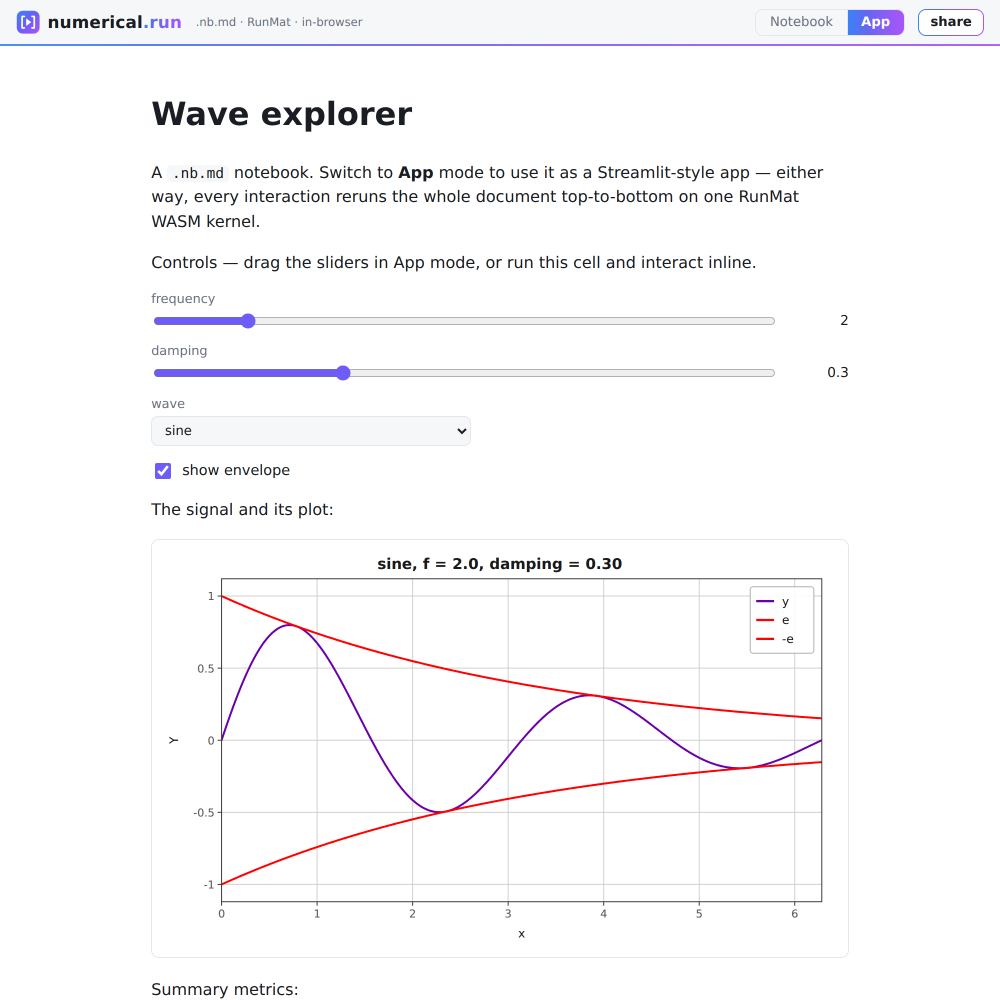
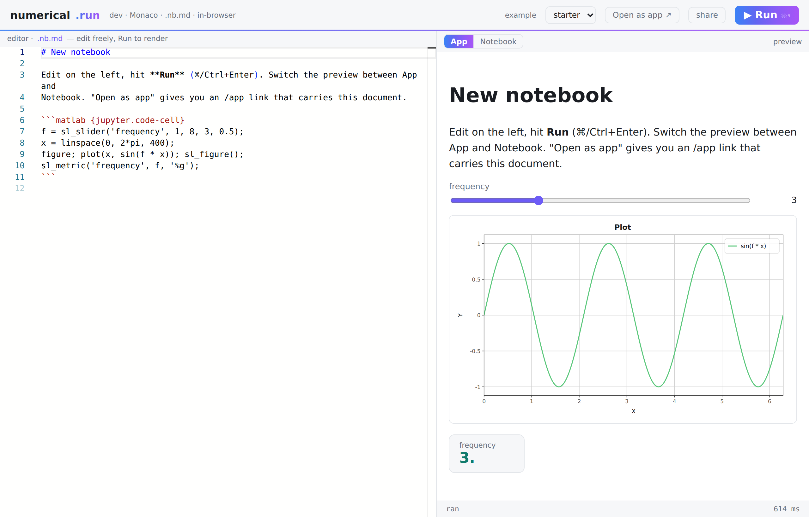

# numerical.run

One `.nb.md` document, two modes — a **notebook** for building and an **app**
for using — running on a single [RunMat](https://github.com/dystr/runmat)
WebAssembly kernel that speaks the Jupyter protocol. Edit as a notebook, ship
as an app, from the same file and the same live session.

Two execution models, one per mode:

- **Notebook mode** — stateful, Jupyter-style. Each cell has its own *Run*
  (and Ctrl/⌘+Enter), executes against the persistent workspace without
  resetting, and updates only its own output. Variables carry across cells.
- **App mode** — Streamlit-style. Every interaction resets the session and
  reruns the whole document top-to-bottom, so the page always reflects a clean
  run — the way [`streamlab`](https://github.com/jeanclawd/streamlab) works.

Widgets are plain MATLAB function calls from
[`streamlab`](https://github.com/jeanclawd/streamlab)'s `sl_*` library — no new
syntax, no `.mlx`, no proprietary format. The serialization is
[**`.nb.md`**](VISION.md#the-nbmd-format): a Markdown-based Jupyter notebook
following [JEP&nbsp;#103](https://github.com/jupyter/enhancement-proposals/pull/103),
so any Jupyter-aware tool can read it and it stays one-hunk-per-cell in git.

A **WYSIWYG editor** (the *＋ Widgets* panel) writes the same `sl_*` calls a
developer would type by hand into the active code cell, then reruns.

See [`VISION.md`](VISION.md) for the design writeup: the execution model, the
two views over one kernel, the `.nb.md` format and how it maps to JEP #103, the
WYSIWYG layer, what's reused verbatim from `streamlab` vs. genuinely new, the IP
posture, and the inspirations (Streamlit, Jupyter, Jupytext/MyST-NB/Quarto,
marimo, Pluto.jl).

## Screenshots

**Notebook mode** — editable code + markdown cells, per-cell output, stateful
execution:



**App mode** — the same `.nb.md` as a Streamlit-style app: code hidden, widgets
and prose in place:



**Dev environment** (`/dev`) — a Monaco editor with a live preview of both
modes, inspired by the zoetrope playground; responsive down to a phone:



## Single-page app

One page, two states chosen by the URL — no separate routes:

- **View** (default) — the `.nb.md` rendered as an app (Streamlit-style), code
  hidden, full width. Monaco is not loaded.
- **Edit** (`?edit`) — a Monaco editor with a live preview (App / Notebook
  tabs). Monaco loads lazily the first time you enter edit, so plain app views
  stay light.

The document comes from the URL, else a built-in default:

```
#code=<base64>   ?code=<base64>   ?gist=<id | raw-url>   (default)
```

Toggling **✎ Edit** / **View ▸** flips state in place (updating the URL, no
reload). **share** copies a `#code=` link that carries the whole document.

## Deploy

- **Self-hosted** — `./deploy.sh` builds the static site (RunMat runtime +
  Monaco vendored locally).
- **Netlify** — `netlify.toml` runs `netlify-build.sh`, which publishes the
  small app files and points the heavy assets (RunMat wasm, Monaco) at jsDelivr,
  so the build stays tiny. All state is in the URL, so a single-page redirect
  serves every path.

## Running it

Everything runs client-side — one RunMat WASM kernel, no server.

```
host/            the app
  index.html     shell (Notebook | App toggle, ＋ Widgets, Run all, share)
  app.js         two views + WYSIWYG over one document and one kernel
  dev.html/.js   the /dev Monaco dev environment (live preview of both modes)
  app.html       the /app headless runner shell
  player.js      /app: load a .nb.md from the URL (base64 / gist) and render
  kernel.js      RunMat WASM session; runCell (stateful) + runAll (full rerun)
  nbmd.js        .nb.md parse / serialize (JEP #103 subset)
  md.js          tiny Markdown → HTML for prose cells
  render.js      widget renderer            (reused from streamlab)
  lib.m          sl_* widget library        (reused from streamlab)
  figrender.mjs  figure SVG renderer        (reused from streamlab)
  examples/*.nb.md
deploy.sh        assemble host/ + RunMat runtime + Monaco → the static site
```

`./deploy.sh` builds the static site (pulling the 52 MB RunMat runtime from an
adjacent `streamlab` deploy). Load an example, edit cells, hit **Run all**, and
toggle **App** to see the same document as a Streamlit-style app. **share**
copies a link that carries the whole `.nb.md` inside its `#nb=` fragment.

Reused verbatim from [`streamlab`](https://github.com/jeanclawd/streamlab): the
RunMat WASM runtime, the `sl_*` widget library, the `%%SL%%` marker protocol,
the figure renderer, and the widget→DOM renderer. New here: the `.nb.md` format,
the notebook view, the stateful-cell vs. full-rerun kernel, the WYSIWYG panel,
and the `/dev` (Monaco) and `/app` (URL-carried) surfaces.
